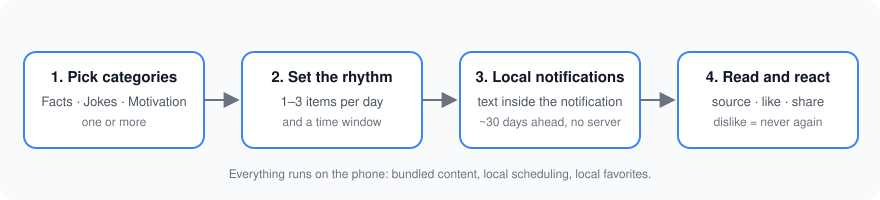

# Damla

*A drop a day.*

Damla is a free, ad-free mobile app (Turkish + English) that sends you one bite-sized item per notification — a fun fact, a joke, or a motivational quote — from the categories you choose, at the times you choose. The text is readable right inside the notification; tap it to see the full item and its source.

**Status:** v1 in development. Not on the stores yet.

## How it works

1. Pick one or more categories: **Facts**, **Jokes**, **Motivation**.
2. Choose how many items you want per day (1–3) and a time window.
3. Damla schedules local notifications about a month ahead and tops them up whenever you open the app. No server, no account.
4. Like an item to keep it in Favorites. Dislike it and you will never see it again.

## Principles

- Free. No ads, no accounts, no analytics. Nothing leaves your phone.
- Every fact links to its source (Wikipedia, CC BY-SA 4.0). Quotes carry their author.
- No repeats until the whole pool has been shown.
- Fully usable without notification permission.

## Tech

React Native + Expo (TypeScript, expo-router) · expo-notifications (local only) · expo-localization + i18n-js · Zustand + AsyncStorage · EAS Build / Submit.

Content ships inside the app as JSON: `content/<lang>/<category>.json`.

## Roadmap

- [ ] v1 app: onboarding, today, item detail, favorites, history, share card, settings, home-screen widget
- [ ] Content pools: 100–150 items per category per language (TR + EN)
- [ ] TestFlight → App Store; Google Play closed test
- [ ] Later: content updates from a backend, personalization, premium tier

Screenshots will be added after the first device build.

## Project docs

- [docs/PRODUCT.md](docs/PRODUCT.md) — product brief and v1 scope
- [STRATEGY.md](STRATEGY.md) — how apps in this portfolio are researched, built and launched

---

## Türkçe

Damla, günde bir bildirimle bir bilgi, bir fıkra ya da bir motivasyon sözü gönderen ücretsiz ve reklamsız bir uygulama. Kategorileri ve saatleri sen seçersin; metin bildirimin içinde okunur, dokununca tamamını ve kaynağını görürsün. Sunucu yok, hesap yok, veri toplanmıyor. Türkçe ve İngilizce içerik havuzları ayrı ayrı hazırlanıyor; makine çevirisi yok.
